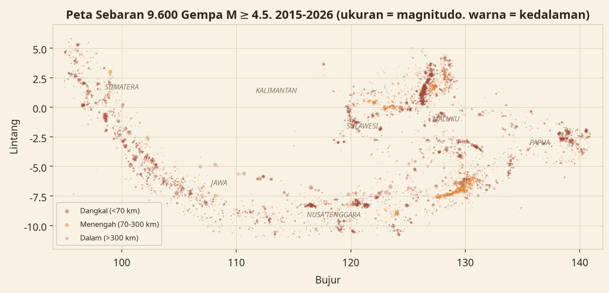

# Analisis Gempa Bumi Indonesia 2015–2026

Indonesia duduk di pertemuan empat lempeng tektonik besar — Indo-Australia,
Eurasia, Pasifik, dan Laut Filipina. Konsekuensinya: gempa adalah bagian dari
kehidupan sehari-hari. Project ini mengukur seberapa sering, seberapa besar,
dan di mana saja gempa itu terjadi, memakai **9.595 kejadian M≥4,5** pada
1 Januari 2015 – 20 Oktober 2026, plus snapshot real-time BMKG.



## Temuan utama

- **9.595 gempa M≥4,5** dalam ±12 tahun — rata-rata **783 kejadian per tahun
  penuh**. Tahun tersibuk: **2019 (1.040 kejadian)**; 2026 sudah mencatat 982
  kejadian padahal baru sampai 20 Oktober.
- **2.233 gempa mencapai M≥5,0; 155 mencapai M≥6,0; 16 mencapai M≥7,0.**
  Gempa terbesar: **M7,8 di 66 km NNW Ende, NTT (15 Agustus 2026)**, kedalaman
  hanya 10 km. Terbesar kedua: M7,6 Kepulauan Tanimbar (10 Jan 2023), lalu
  M7,5 Palu, Sulawesi (28 Sep 2018).
- **71,3% gempa bersifat dangkal (<70 km)** — kelas yang paling berpotensi
  merusak karena energinya dekat ke permukaan. Kombinasi dangkal + M≥6 terjadi
  **106 kali**. Kedalaman median hanya 36,2 km; yang terdalam 652,5 km.
- **Wilayah teraktif: Halmahera & Maluku Utara (2.061 kejadian)**, disusul
  Sumatera (1.514), Papua (1.108), dan Sulawesi (1.061). Kalimantan nyaris
  bebas gempa (15 kejadian) — jauh dari batas lempeng.
- **17 gempa berflag tsunami** pada katalog USGS, termasuk M7,3 Laut Banda
  (24 Jun 2019) dan M7,3 Laut Flores (14 Des 2021). Flag ini berarti "dinilai
  berpotensi", bukan bukti tsunami merusak terjadi.
- **Snapshot BMKG Oktober 2026:** 10 gempa M5+ dalam 18 hari pertama, termasuk
  M6,1 Kodi, Sumba Barat Daya (4 Okt), M5,7 Pohuwato, Gorontalo (12 Okt),
  M5,7 Sukabumi, Jawa Barat (11 Okt), dan M5,3 Labuan Bajo, NTT (18 Okt).

## Sumber data (dinyatakan terbuka)

| Sumber | Peran | Akses |
|---|---|---|
| **USGS FDSN Event API** | Katalog historis 2015–2026 (kotak batas Indonesia, M≥4,5) | Publik, tanpa kunci |
| **BMKG TEWS API** | Snapshot terkini: gempa terbaru, 15 gempa M5+, 15 gempa dirasakan | Publik, tanpa auth |

Dari 10.841 kejadian mentah USGS, 1.246 dikeluarkan karena berlabel negara
lain (Filipina, Malaysia, Papua Nugini, Palau) — kotak batas memang menangkap
pinggiran tetangga. 670 kejadian berlabel "Timor Leste" dipertahankan karena
episentrumnya berada di perairan Indonesia utara/timur Pulau Timor.
Detail lengkap, termasuk aturan penentuan wilayah dan kelas kedalaman:
[data/SOURCES.md](data/SOURCES.md).

## Struktur project

```
├── README.md                  dokumen ini
├── findings.json              semua temuan (format mesin, dari scripts/analyze.py)
├── analysis.ipynb             notebook analisis (ringkasan + chart utama)
├── data/
│   ├── gempa_katalog_2015_2026.csv   katalog bersih (9.595 baris)
│   ├── bmkg_terkini.csv              snapshot BMKG 15 gempa M5+
│   ├── bmkg_dirasakan.csv            snapshot BMKG 15 gempa dirasakan
│   ├── bmkg_autogempa.csv            gempa terbaru saat pengambilan
│   ├── SOURCES.md                    asal & aturan data per sumber
│   └── raw/                          JSON mentah BMKG + GeoJSON USGS
├── scripts/
│   ├── fetch_data.py          unduh ulang kedua sumber
│   ├── assemble.py            rakit CSV bersih + aturan wilayah/kedalaman
│   ├── analyze.py             hitung findings.json + 12 chart
│   ├── load_to_sqlite.py      bangun data/gempa_bumi.db (star schema)
│   └── build_powerbi.py       bangun CSV kit Power BI + pratinjau
├── sql/queries.sql            8 query verifikasi (SQLite)
├── charts/                    12 visualisasi PNG
└── powerbi/                   kit dashboard: 3 CSV star schema, DAX,
                               layout 4 halaman, panduan rakit, pratinjau
```

## Reproduksi

```bash
pip install pandas matplotlib
python scripts/fetch_data.py      # 1. unduh BMKG + USGS
python scripts/assemble.py        # 2. rakit katalog bersih
python scripts/analyze.py         # 3. temuan + chart
python scripts/load_to_sqlite.py  # 4. database verifikasi
python scripts/build_powerbi.py   # 5. kit Power BI
```

Setiap angka di README, PPT, dan modul dihitung dari `findings.json` dan bisa
dicek silang dengan `sql/queries.sql` terhadap `data/gempa_bumi.db`.

## Deliverables

- **PPT portofolio**: `Portofolio-Analisis-Gempa-Bumi.pptx` (10 slide, 16:9)
- **Modul belajar**: `Modul-Analisis-Gempa-Bumi.pdf` (untuk pemula, termasuk bab Power BI)
- **Dashboard Power BI**: rakit dari folder `powerbi/` mengikuti `build_guide.md`

---
Dibuat oleh **Baghiz Asshiddiqie Arasya** — portfolio Data Analyst.
Data: USGS (domain publik) & BMKG (API publik). Diambil 20 Oktober 2026.
